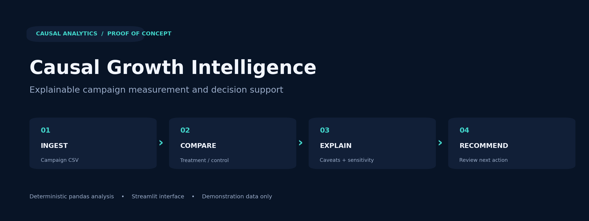
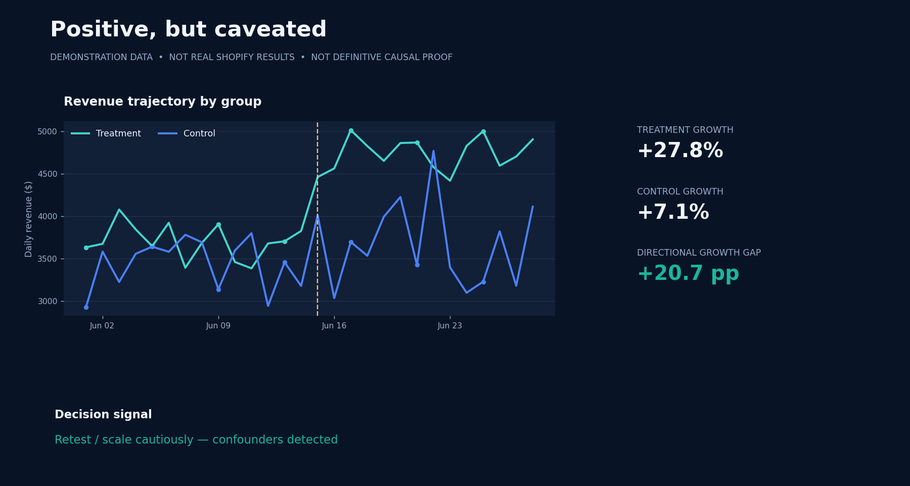
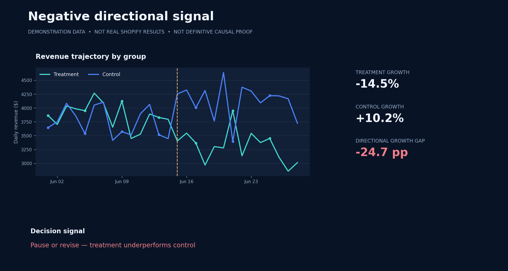

<div align="center">

# Causal Growth Intelligence

### Explainable Campaign Analysis & Decision-Support Prototype

**Python · pandas · Streamlit · Plotly · Counterfactual reasoning (directional)**

[**Launch Live Streamlit App**](https://huggingface.co/spaces/amirkhoshnafs/causal-campaign-analyst-agent) · [**Read the 41-page case study**](docs/Enrich_Labs_Case_Study_Public.pdf) · [**Explore the methodology**](docs/methodology.md)



</div>

> **Project scope:** This is a deterministic, explainable **proof of concept** for marketing campaign comparison. It is **not** a production marketing platform, autonomous LLM agent, fitted causal-ML model, or validated causal impact study. Data in the included demos are simulated. The purpose is to make measurement assumptions and business decisions inspectable.

## At a glance

| Dimension | Implementation |
|---|---|
| Business problem | Did a campaign create additional results, or did the market improve anyway? |
| Audience | Shopify-first ecommerce teams and growth analysts |
| Input | Campaign CSV or one of two deterministic demo datasets |
| Analysis | Pre/post treatment-control comparison, directional growth gap, spend-efficiency estimate |
| Explainability | Formula trace, detected caveats, heuristic assessment, decision rationale, sensitivity scenarios |
| Output | KPI cards, two Plotly visualizations, and an explainable next-action card |
| Stack | Python, NumPy, pandas, Plotly, Streamlit |
| Companion research | A 41-page product-strategy case study on Enrich Labs |

## The problem

Campaign dashboards easily answer **what happened**. They often fail to distinguish a marketing intervention from background demand, discounts, product stock changes, or overlapping campaigns. This project demonstrates an interpretable workflow that compares treatment and control groups over pre/post periods, flags alternative explanations, and presents the logic behind a suggested next step.

The accompanying case study proposes a *Causal Growth Intelligence Layer* for a Shopify-first AI marketing product, coupling execution with measurement and human review. It is a **proposal**, not a claim that the company currently has this system.

## Demo analysis — two contrasting scenarios

Both figures below are **generated from the same synthetic data generators as the application**. They are analytical previews, **not screenshots of the deployed Streamlit interface**.

<table>
<tr><td width="50%"><strong>Positive but caveated</strong><br/></td>
<td width="50%"><strong>Negative directional signal</strong><br/></td></tr>
</table>

The **positive** demo contains a post-period discount that triggers a warning; the **negative** demo exercises the branch that recommends pausing or revising an underperforming campaign. Neither scenario constitutes empirical proof of causal impact.

**[Open the live demo →](https://huggingface.co/spaces/amirkhoshnafs/causal-campaign-analyst-agent)**

## What the application actually does

1. **Accepts input:** upload a CSV or select a built-in positive/negative demo.
2. **Validates columns:** date, group, period, revenue, spend, and campaign flags; checks for four treatment/control × pre/post combinations.
3. **Computes comparisons:** daily revenue means, within-group changes, and the difference between relative growth rates.
4. **Flags context:** discounts, low stock, traffic imbalance, campaign overlap, and very small datasets when detectable from supplied fields.
5. **Explains results:** KPI cards, charts, formula traces, descriptive warnings, deterministic recommendation rationale, and scenario-based sensitivity checks.
6. **Keeps the decision human-reviewed:** no connected ad-platform write action or autonomous budget execution is present.

The logic is **deterministic pandas code**. The app has no LLM in the calculation pipeline and does not train a predictive or heterogeneous treatment-effect model.

## Run locally

Requires Python 3.10+.

```bash
python -m venv .venv
# Activate the venv using your OS and shell
python -m pip install -r requirements.txt
streamlit run app.py
```

Choose **Use positive demo dataset**, **Use negative demo dataset**, or upload a CSV matching [`docs/data-dictionary.md`](docs/data-dictionary.md). Two generated CSV samples are provided under [`data/`](data/).

### Project files

```text
causal-growth-intelligence/
├── app.py                                # Streamlit application
├── requirements.txt                      # Runtime dependencies
├── requirements-dev.txt                  # Testing dependencies
├── data/
│   ├── sample_campaign_positive.csv
│   └── sample_campaign_negative.csv
├── assets/
│   ├── cover.png                          # Project cover (not app screenshot)
│   ├── positive-scenario.png              # Synthetic-data analytical preview
│   └── negative-scenario.png
├── docs/
│   ├── Enrich_Labs_Case_Study_Public.pdf  # Sanitized 41-page research case study
│   ├── case-study.md                      # Research-to-prototype summary
│   ├── methodology.md                     # Formulas and identification boundaries
│   ├── data-dictionary.md                 # CSV schema
│   ├── limitations.md                     # Known limitations and research next steps
│   └── deployment.md                      # Hugging Face Space publishing guide
├── tests/
│   └── test_analysis.py
└── .github/workflows/tests.yml
```

## Methodological honesty — please read

The app's metric called **estimated uplift** is the **difference in treatment and control relative growth rates**, not a fitted CATE or standard dollar-scale difference-in-differences coefficient. Its **estimated incremental revenue** is a simplified *scenario calculation*, not identified causal revenue. The app's label **ROI** is based on incremental revenue / campaign spend and therefore **should not be interpreted as profit-based ROI**; it is closer to an estimated incremental-revenue-to-spend ratio.

Its High/Medium/Low **confidence** is a **rule-based data-quality/caveat assessment**, not a p-value, confidence interval, or calibrated probability. Parallel trends, interference, selection bias, and other identification assumptions are not verified by the application. These are documented in more detail in [`methodology.md`](docs/methodology.md) and [`limitations.md`](docs/limitations.md).

The accompanying PDF records the **original June 2026 PoC methodology**; it should be read as historical project documentation, not as an independently validated causal study or as a claim of current production capabilities.

## Technical quality and tests

The project includes tests for built-in scenarios, required-input validation, caveat detection, zero-spend handling, and deterministic metric behavior.

```bash
python -m pip install -r requirements-dev.txt
pytest -q
```

The included `app.py` retains the supplied application logic with a small **Plotly/Pandas date-annotation compatibility fix**. If the hosted Space runs an earlier commit, sync this file to Hugging Face to align the public demo with this repository; see [`deployment.md`](docs/deployment.md).

## Case study

The [**public case study PDF**](docs/Enrich_Labs_Case_Study_Public.pdf) examines Enrich Labs' Shopify distribution strategy, competitive positioning, product opportunities, a proposed explainable decision layer, implementation roadmap, and the accompanying Streamlit PoC.

The public PDF has the specific program-identification and video-link lines removed, including repeated occurrences. The original document remains unchanged outside this repository.

## Author

**Amir Khoshnafs** — [GitHub](https://github.com/amirkhoshnafs) · [Portfolio](https://khoshnafs.netlify.app/) · [Live demo](https://huggingface.co/spaces/amirkhoshnafs/causal-campaign-analyst-agent)

*Research and prototype source provided by the author; project is published for portfolio and educational evaluation. No open-source license is granted by default.*
